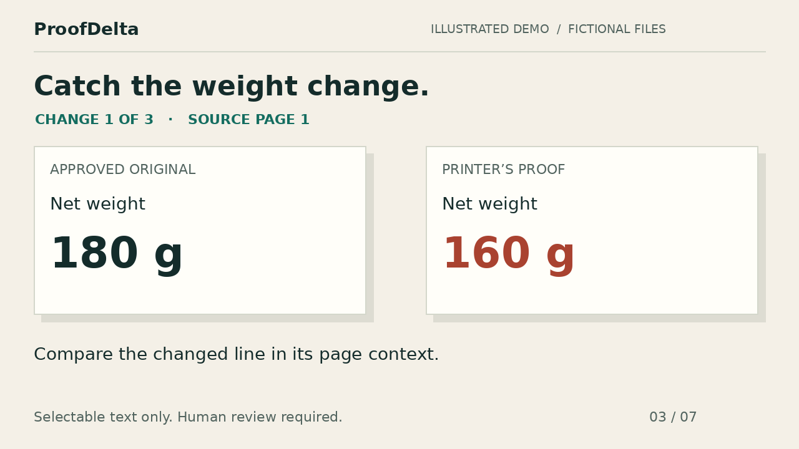

# ProofDelta

A packaging-proof review prototype: compare selectable text from an approved PDF and a printer’s proof, then work through the differences with page context.

**Status:** working prototype. Checkout is a simulation; no real payments or PayPal integration. The Rust service runs locally. A public hosted demo is not yet available.

## See the workflow

[Watch the narrated walkthrough](launch/media/ProofDelta-Raya-Voice.mp4) — approximately 35 seconds, narrated with the existing Raya — My Voice clone in HeyGen at natural speed, matching the ReleaseRadar voice. It uses the real fictional sample differences; it is an illustrated walkthrough, not a screen recording. [Original silent edition](launch/media/ProofDelta-demo.mp4).

[普通话演示视频（Raya 配音）](launch/media/ProofDelta-Mandarin-Raya.mp4) — approximately 37 seconds with Simplified Chinese on-screen labels; the original English sample PDFs are preserved.



The two-page sample contains three differences: net weight changes from **180 g to 160 g**, **sunflower oil becomes canola oil**, and page 2 gains **Printer reference: 221B**.

[Approved sample PDF](dist/samples/approved-oat-bites.pdf) · [Printer’s sample PDF](dist/samples/printer-oat-bites.pdf)

## Try it locally

Use a recent Node.js release, npm, Python 3 for static hosting, and a current stable Rust toolchain for the optional service.

```sh
npm ci
npm run build
python3 -m http.server 4173 --directory dist --bind 127.0.0.1
```

Open http://127.0.0.1:4173 and choose **Try fictional sample**. Select a change, mark it reviewed or flag it, then open **Preview checkout**. Cancel to return to review, or simulate success to download an HTML report. No money moves.

For the local Rust service instead:

```sh
cargo run --manifest-path backend/Cargo.toml
```

Open http://127.0.0.1:8787. The same React frontend now calls Rust for the simulated checkout. PDF parsing remains in the browser.

## What works

- Browser-local selectable PDF text extraction with vendored PDF.js.
- Layered and flat extracted-text views, original/proof context and page/line references.
- J/K change navigation, R to mark reviewed, F to flag for follow-up, and review tally. Focus the workbench for shortcuts.
- Responsive layout, explicit flat view and reduced-motion styling.
- Synthetic PDF downloads and an HTML report containing differences, decisions and extracted page context.
- Explicit A$39 checkout simulation with cancel/back flow. The static frontend works without a server API.

## Architecture and privacy

React source is in `src/`; esbuild produces `dist/app.js`. The vendored PDF.js reader loads lazily. PDF bytes, filenames, extracted text and review decisions are not submitted to a service. Files and decisions live in tab memory and clear on reload/new comparison. Downloaded reports contain the reviewed text and should be shared deliberately.

`backend/` contains a native Rust/Axum development service bound to loopback. It serves the same assets and exposes `GET /api/health`, `GET /api/config`, and `POST /api/checkout/simulate`. The simulation accepts only an empty body plus an explicit simulation header. There is no upload or live-payment API. The service is tested locally, not publicly deployed.

## Verification

```sh
npm test
cargo test --manifest-path backend/Cargo.toml
node tests/run-service.mjs
```

Tests exercise comparison, PDF parsing, synthetic sample differences, report escaping, source attribution, simulation contracts and live local HTTP integration. Browser review previously covered sample/file comparison, guided decisions, flat view, checkout cancel/back/Escape, report export and reset. The launch video is an illustration, not test evidence.

## Limits

Text comparison only: no OCR, artwork/pixel diff, barcode checks, print-colour validation, legal compliance assessment or print approval. Pages are paired by number; inserted/reordered pages can produce extra differences. Whitespace is normalized. Limits are 30 MB / 200 pages per PDF, plus extracted text bounds. Review state is not a durable audit trail. Reviewed means inspected, not approved for print.

## Demo production

`launch/render_demo.py` deterministically renders the walkthrough with Pillow, FFmpeg and Poppler using the included fictional PDFs. Run it from the repository root; output goes to `tmp/launch/`. Fonts use the installed DejaVu Sans family.

Third-party PDF.js and font licensing notices are retained under `dist/pdfjs/`. No new open-source license is granted for project-authored code in this package; dependency licenses remain applicable.
